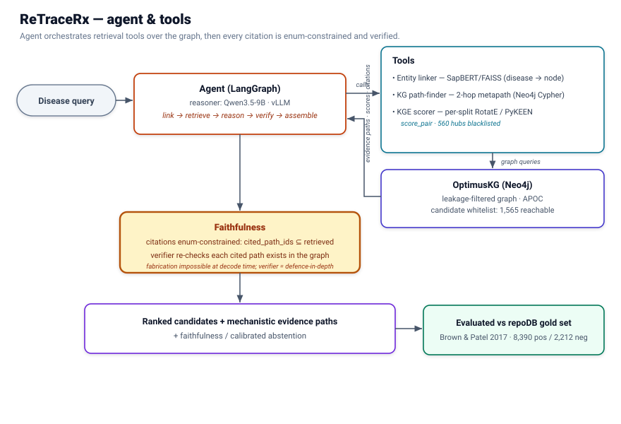

# ReTraceRx

**A self-hosted, faithfulness constrained Graph-RAG drug-repurposing Agent**

ReTraceRx grounds an LLM agent in a leakage controlled biomedical knowledge graph so that **every citation it makes is verifiable or it abstains**. Its current contribution is not beating baselines on recovery — novel (graph-independent) recovery is structurally near-zero for *every* system at 2-hop, and we report it that way — but **faithfulness** (0 fabricated citations across ~7,300 picks), **calibrated abstention** (declines rather than invents), and a precise, reproducible diagnosis of *why* 2-hop retrieval is blind to novel repurposing.

---

## Key results

| Result | Value | Where |
|---|---|---|
| Fabricated citations (grounded, full holdout) | **0** across ~7,300 picks | `data/phaseC/c3_faithfulness_*` |
| Hallucination gap vs ungrounded LLM | **0.74–0.77** | `c3_faithfulness_*` |
| Abstention rate (declines, never invents) | **2–6%**; confident-invention **0** | `data/phaseC/c8/c8_calibration_*` |
| Calibration AUROC (confidence → faithful) | **≈ 0.99** (self-consistency) | `c8_calibration_*` |
| Novel (Stratum-A) recovery, all systems | **≈ chance** (agent indistinguishable from KGE) | `artifacts/d7_stats/`, `data/phaseC/paired/paired_summary.csv` |
| KGE true-negative discrimination (repoDB) | **AUROC CIs all include 0.5** | `artifacts/d5_discrimination/d5b_discrimination_*` |

Full write-up and reference list: **[`ReTraceRx_Report.md`]**.

---

## Architecture



A disease query drives a LangGraph agent that orchestrates retrieval tools over the graph; every cited path is **enum-constrained at decode time** (`cited_path_ids ⊆ retrieved path_ids`) and re-verified against the graph. Detailed five-phase view: [`ReTraceRx_architecture.svg`](ReTraceRx_architecture.svg).

---

## Repository layout

The repo is **flat** — all executable stages live in `scripts/`, prefixed by phase (`a*`, `b*`, `c*`, `d*`, `e*`). Bulk data and trained artifacts are `.gitignore`d and regenerated from pinned inputs.

```
scripts/                    # all stages, flat
  a1..a8_*.py               # A · data foundations (graph, holdouts, whitelist, crosswalks)
  d1_assemble_kge_data.py   # D1 · KGE data
  d2_train_kge.py           # D2 · per-split RotatE
  b1..b7_*.py               # B · linker, 2-hop retriever, ranker, contract, tools (b6_tools)
  c0..c8_*.py               # C · agent, verifier, ungrounded/graph_rag rankers, faithfulness, calibration
  d3..d8_*.py               # D · stratified eval, discrimination, D6 matrix, D7 CIs, D8 errors
  e0_config.py              # E · single source of truth (pins, ports, seeds, paths)
  e0_preflight.py           #      input gate; e0_bootstrap.sh builds the serve venv
  e1_up.sh · e1_healthcheck.py     # bring up + verify the 2-container stack
  e2_api.py · e2_smoke_api.py      # FastAPI service + smoke test
  e4_ui.py                  #      Streamlit evidence-subgraph explorer
  e6_pick_demos.py          #      demo-disease picker (curation aid)
  e5_dashboard.py           #      (optional) local eval viz — not a deliverable
  c1_serve_vllm_fp16.sh     # vLLM FP16 serve command (digest-pinned image)
  docker-compose.phaseE.yml # Neo4j + vLLM (the two containers)
  neo4j_env.sh · okg_env.sh · serve_env.sh   # session spines
docs/                       # retrieval_contract_v1.md (+ .schema.json)
data/  artifacts/  neo4j/   # generated / mounted (gitignored)
requirements-phaseC.lock 
requirements-serve.lock
ReTraceRx_Report.md 
ReTraceRx_architecture*.svg
```

---

## Requirements

- Linux + **Docker** (Compose v2), a single **GPU with ≥ 24 GB VRAM** (FP16 weights ~18 GB + KV-cache; developed on an L40S-class card).
- **Neo4j 5.26.x community** + **APOC 5.26.28** (run as a container).
- **vLLM** (digest-pinned image) serving **Qwen/Qwen3.5-9B** in FP16.
- Python **3.12**, **[uv](https://github.com/astral-sh/uv)**, `torch 2.13.0+cu130` (pinned in the lockfiles).

Two virtual environments: **`.venv-data`** for the data/eval pipeline (Phases A–D) and **`.venv-serve`** for serving + demo (Phase E).

---

## Setup

### 1. Python environments (uv)

```bash
# data/eval pipeline env
uv venv .venv-data && source .venv-data/bin/activate
uv pip install -r requirements-phaseC.lock       # (or the phase-A/B locks, per stage)

# serving/demo env (also builds requirements-serve.lock)
bash scripts/e0_bootstrap.sh                      # creates .venv-serve; verifies the torch pin holds
```

### 2. Neo4j (leakage-filtered graph)

The graph lives in a host bind (`neo4j/data`), with APOC in `neo4j/plugins`. `neo4j_env.sh` starts the container, waits for Bolt, exports `NEO4J_*`, and asserts APOC + the filtered variant (a leakage edge type must return 0). Auth `neo4j/retracerx`; Bolt `:7687`, browser `:7474`.

```bash
source scripts/neo4j_env.sh
```

> Never `chown` `neo4j/data` (the DB owns it). If you swap the APOC jar, reclaim `neo4j/plugins` for your user first — `e1_up.sh` does this.

### 3. vLLM (reasoner serving)

`c1_serve_vllm_fp16.sh` launches the **digest-pinned** vLLM image serving Qwen3.5-9B in FP16 (`--served-model-name reasoner`, `--max-model-len 8192`, `--seed 20260727`, API key `retracerx-local`). Clients reach it at `http://localhost:8000/v1` as model **`reasoner`**. Do not substitute `:latest`.

---

## Reproduce the pipeline (run-order)

**Dependency spine (two non-obvious orderings): `A → D1/D2 → B → C → D3–D8 → E`.** The KGE model is trained *before* B because the B4 ranker calls it as `score_pair`; the D6 ablation matrix is *completed after* C because the grounded/ungrounded columns come from the agent.

Session preamble depends on the phase:

```bash
# Phases A–D (data/eval)
export PATH="$HOME/.local/bin:$PATH"
source .venv-data/bin/activate && source scripts/okg_env.sh
export PYTHONPATH="$PWD/scripts"
docker start retracerx-neo4j && source scripts/neo4j_env.sh

# Phase E (serving/demo) — serve_env.sh brings up Neo4j + vLLM and exports NEO4J_*, VLLM_*
export PATH="$HOME/.local/bin:$PATH"
source .venv-serve/bin/activate && source scripts/okg_env.sh
source scripts/serve_env.sh
export PYTHONPATH="$PWD/scripts"
```

| Phase | Entry points | Produces | 
|---|---|---|---|
| **A** Data foundations | `a1…a8_*.py`, `a3_import.sh` | filtered OptimusKG-2.0 in Neo4j; `kge_triples.tsv`; frozen `data/holdout/`; reachable whitelist (1,565); crosswalks | 
| **D1/D2** KGE data + train | `d1_assemble_kge_data.py`, `d2_train_kge.py` | per-split RotatE (`artifacts/kge_rotate_*`), `d1_meta.json` | 
| **B** Graph-RAG retrieval | `b1…b7_*.py`, `neo4j_env.sh` | SapBERT/FAISS linker, 2-hop retriever, ranker, **contract v1.0**, `b6_tools` | 
| **C** Agent + faithfulness | `c0…c8_*.py`; vLLM | grounded agent + verifier, ungrounded/graph_rag rankers, `d4_perquery_*`, hallucination + calibration | 
| **D** Complete the matrix | `d3…d8_*.py`, `d5b_*`, `d7_*` | `d3_metrics_*`, D5(b) discrimination, **D6 matrix**, D7 per-cell + paired CIs, D8 errors | 
| **E** Deploy + demo | `e0…e6_*`, `docker-compose.phaseE.yml` | preflight, 2-container stack, FastAPI, evidence-subgraph UI, demo picker | 

Everything upstream of E is frozen and reproducible from pinned inputs (seed **`20260727`**; gates such as the Phase-D KGE-data assembly check pass 4/4).

---

## Deploy & demo (Phase E)

From a shell with the **Phase-E preamble** sourced:

```bash
python scripts/e0_preflight.py          # input gate — verifies every consumed artifact + pin
bash   scripts/e1_up.sh                  # bring up Neo4j + vLLM; waits for readiness
python scripts/e1_healthcheck.py         # verify model id, deterministic guided JSON, APOC/filtered variant, GPU budget

# API + UI (host app; reaches the containers over localhost)
uvicorn e2_api:app --host 127.0.0.1 --port 8080          # FastAPI  → :8080
streamlit run scripts/e4_ui.py --server.port 8501                # explorer → :8501
python scripts/e2_smoke_api.py                           # optional smoke test

# pick strong demo diseases (grounded recovers a recognizable true drug, ungrounded misses)
python scripts/e6_pick_demos.py --split disease_cold --mode plus_true
```

Over SSH, forward the ports: `ssh -N -L 8080:localhost:8080 -L 8501:localhost:8501 <host>`.

The app has two faces: the **evidence-subgraph explorer** (disease → ranked candidates → cited paths as a subgraph beside the triples/sources, with disambiguation and abstention as first-class outcomes) and the **grounded-vs-ungrounded contrast**.


**Demo Video:** [retracerx_demo_video.mov](https://github.com/madkad-ds/retracerx/blob/173a7874ed588ed08f9b3caccd2abf0808c40bb6/retracerx_demo_video.mov)

---

## Where the results live

| Artifact | Content |
|---|---|
| `data/phaseC/c3_faithfulness_<split>_plus_true.json` | hallucination gap, unfaithful breakdown (`unsupported` vs `citation_failure`), CIs |
| `data/phaseC/c8/c8_calibration_<split>.json` | abstention, confident-invention, conf→faithful AUROC, reliability bins |
| `data/phaseC/paired/paired_summary.csv` | agent − baseline ΔMRR (Stratum-A) with paired CIs + significance |
| `artifacts/d7_stats/d7_percell_ci.csv` · `d7_paired_*.json` | per-cell recovery MRR/Hits + bootstrap CIs; pairwise significance |
| `artifacts/d3_eval/d3_metrics_<split>_<mode>.json` | stratified recovery + reachability ceiling |
| `artifacts/d5_discrimination/d5b_discrimination_<split>.json` | repoDB true-negative AUROC/AUPRC + CIs |

---

## Determinism & reproducibility

- Greedy decoding + fixed seed (`20260727`) → **byte-identical** agent replays.
- One metric engine, pluggable rankers: the KGE ranker reproduces the standalone D3 evaluation to the digitReTraceRx_architecture.svg.
- Digest-pinned vLLM image; per-phase lockfiles; the serve venv is built under a torch constraint so the `2.13.0+cu130` pin cannot move.

---

## Limitations & roadmap

- **2-hop Stratum-A ceiling** is the binding limitation: a novel candidate lacking a shared disease-gene is unreachable by the `disease → gene → drug` metapath. This is why novel recovery is ~0 for every system.
- **3-hop retrieval** is the scoped next lever expected to move novel recovery off zero.

---

## Data sources, licensing & attribution

Bundle a `NOTICE` file with attribution for all upstream sources before distribution. Notably:

- **repoDB** (gold positives/negatives) — Brown & Patel, *Scientific Data* 2017; CC-BY 4.0. Using repoDB additionally requires citing **AACT**, **DrugCentral**, and **UMLS**.
- **Knowledge graph** — OptimusKG-2.0 (derived from PrimeKG; Chandak, Huang & Zitnik, *Scientific Data* 2023). Confirm and reproduce the upstream license terms.
- **SapBERT** (Liu et al., NAACL 2021), **RotatE/PyKEEN**, **Qwen/Qwen3.5-9B**, **vLLM** — cite per their model cards / papers; confirm licenses for redistribution.

> Verify each source's exact license and required citations against its distribution before release. Ship code and pinned configuration; do not redistribute third-party data you are not licensed to.

---

## Citation

If you use this work, cite the report and the upstream sources listed in **[`ReTraceRx_Report.md`](ReTraceRx_Report.md)** (References).
